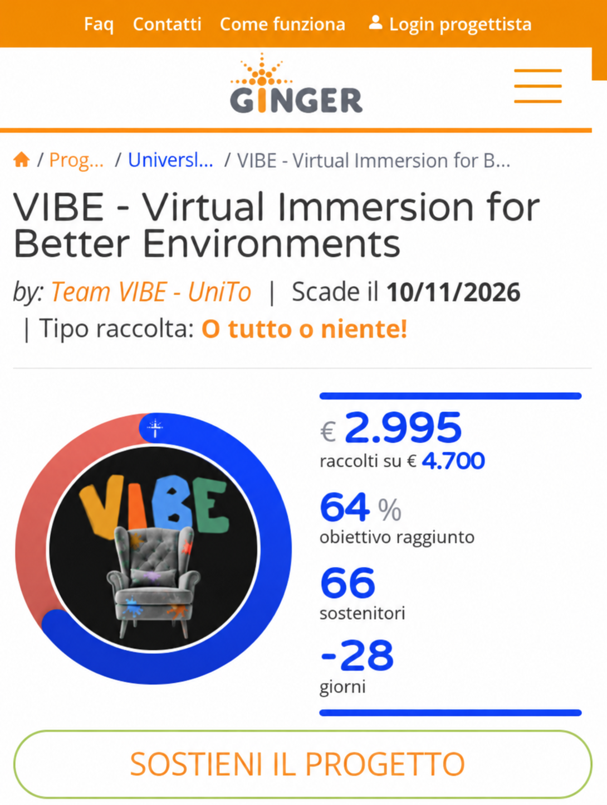
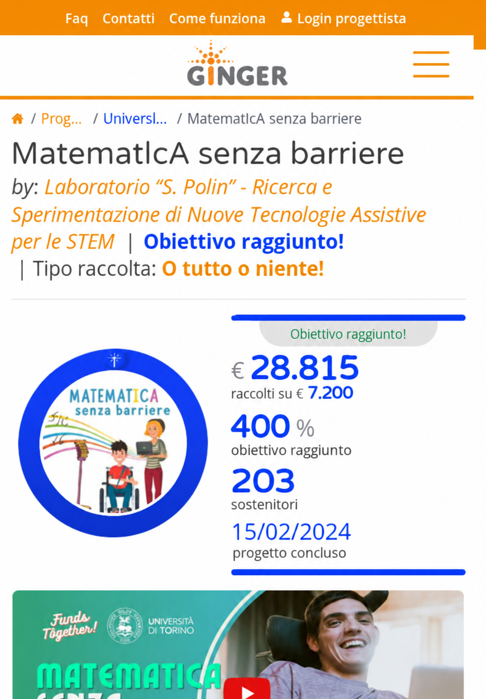
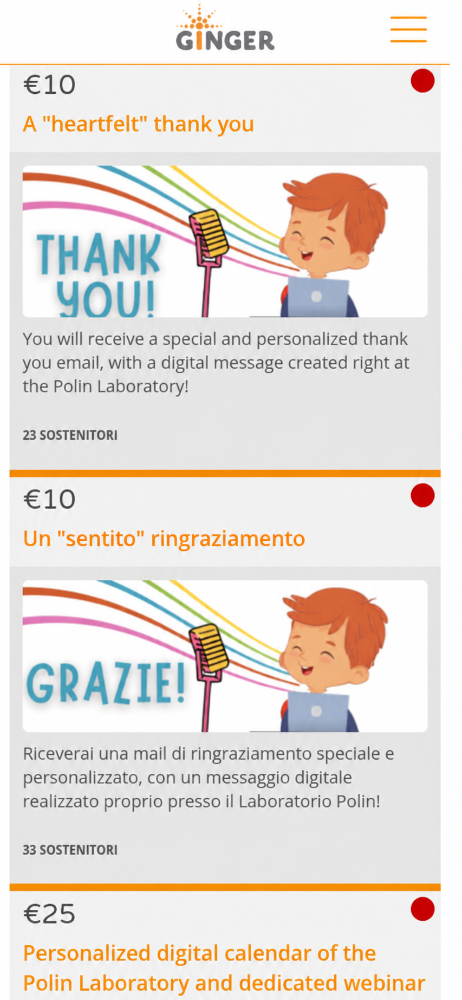
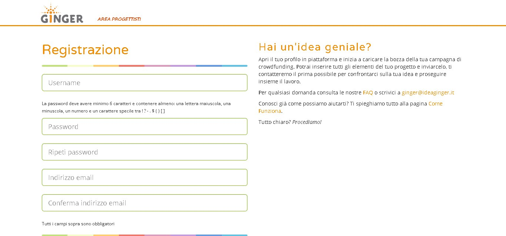

# Assignment 1 - Valutazione euristica di IdeaGinger

> Documento pronto per essere integrato nell'elaborato del **Gruppo A (4 componenti)**.  
> Componenti del gruppo: **[NOME 1 DA INSERIRE]**; **[NOME 2 DA INSERIRE]**; **[NOME 3 DA INSERIRE]**; **[NOME 4 DA INSERIRE]**.

**Data della valutazione:** 13 ottobre 2026  
**Ambienti verificati:** browser Chromium/Codex, desktop 1280 x 720; viewport mobile 390 x 844; navigazione da tastiera; ispezione della struttura accessibile/DOM e degli stili calcolati.  
**Perimetro:** non sono stati effettuati pagamenti, non e stato creato alcun account e non e stato risolto il reCAPTCHA.

---

## 1. Obiettivo e metodo

Questa parte applica le 10 euristiche di Nielsen alle tre pagine assegnate e ai task realistici collegati. L'analisi segue la consegna 2026/27 e il modello degli elaborati precedenti valutati 10/10: task espliciti, evidenze numerate, una sola euristica prevalente per problema, severita motivata tramite **frequenza, impatto e persistenza**, proposta concreta e confronto desktop/mobile.

L'accessibilita e stata verificata come approfondimento trasversale, senza sostituire la valutazione euristica. Sono stati controllati in particolare i temi trattati nelle slide del corso: contrasto, uso non esclusivo del colore, etichette persistenti, testo alternativo, gerarchia dei titoli, nomi accessibili dei controlli, focus visibile, ordine di tabulazione e reflow mobile.

### Pagine analizzate

| Codice | Pagina | URL | Stato osservato |
|---|---|---|---|
| PG1 | MatematIcA senza barriere | <https://www.ideaginger.it/progetti/matematica-senza-barriere.html> | Conclusa il 15/02/2024, 400%, 203 sostenitori |
| PG2 | VIBE - Virtual Immersion for Better Environments | <https://www.ideaginger.it/progetti/vibe-virtual-immersion-for-better-environments.html> | Attiva, scadenza 10/11/2026, 64%, 66 sostenitori |
| PG3 | Registrazione area progettisti | <https://www.ideaginger.it/areaprogettisti/signup.html> | Modulo di apertura profilo/candidatura |

### Task verificati

| Task | Obiettivo dell'utente | Pagine |
|---|---|---|
| T1 | Confrontare due progetti UniTo e capire stato, scadenza e avanzamento | PG1, PG2 |
| T2 | Capire obiettivo, proponente e uso previsto dei fondi | PG1, PG2 |
| T3 | Esplorare come sostenere un progetto, senza pagamento | PG1, PG2 |
| T4 | Capire come proporre una propria campagna e iniziare la registrazione, senza creare l'account | PG3 |
| T5 | Completare i percorsi con tastiera, bassa visione o lettore di schermo | PG1, PG2, PG3 |

### Scala di severita

| Livello | Significato |
|---:|---|
| 0 | Non e un problema di usabilita |
| 1 | Cosmetico; priorita bassa |
| 2 | Minore; difficolta limitata ma da correggere |
| 3 | Grave; ostacola significativamente il task |
| 4 | Critico; impedisce un task essenziale |

---

## 2. Risultati in sintesi

Sono stati individuati **10 problemi specifici/trasversali** in questa parte: **7 gravi (severita 3)** e **3 minori (severita 2)**. Sono state inoltre confermate su nuove pagine **tre ricorrenze** gia registrate nella parte di antofallea; queste vanno consolidate nel documento di gruppo e **non contate due volte**.

Priorita immediata:

1. correggere lo stato contraddittorio di VIBE (64% ma “obiettivo raggiunto”);
2. rendere menu e controlli utilizzabili da tastiera e tecnologie assistive;
3. aggiungere etichette persistenti e semantica corretta al modulo di registrazione;
4. correggere i contrasti cromatici non conformi;
5. rimuovere o trasformare in sola lettura i controlli di sostegno nelle campagne concluse.

---

## 3. Log dettagliato dei problemi

### A-P01 - VIBE comunica contemporaneamente uno stato raggiunto e non raggiunto

| Campo | Valutazione |
|---|---|
| **Pagina / task** | PG2 - T1, T3 |
| **Problema e conseguenze** | Il riquadro mostra **64%**, “€ 2.995 raccolti su € 4.700” e, subito sotto, l'etichetta **“obiettivo raggiunto”**. L'utente non sa se la condizione “tutto o niente” sia stata soddisfatta, se la campagna abbia ancora bisogno di sostegno o se i fondi saranno restituiti. Il dato errato e collocato nel punto decisionale principale e si ripete anche su mobile. |
| **Euristica prevalente** | **H1 - Visibilita dello stato del sistema.** Il sistema fornisce due stati incompatibili invece di un feedback affidabile. |
| **Severita** | **3 - grave.** Frequenza: alta per chi visita PG2; impatto: alto sul task di sostegno; persistenza: alta finche la campagna resta attiva. Non e 4 perche importo, percentuale e scadenza permettono di dedurre lo stato corretto. |
| **Miglioramento** | Calcolare l'etichetta dalla stessa sorgente della percentuale: “64% dell'obiettivo - mancano € 1.705”. Mostrare “Obiettivo raggiunto” solo da 100% in poi; aggiungere un test automatico che impedisca stati incompatibili. |
| **Evidenza** | Figura 1. |



*Figura 1 - Ritaglio mobile: i valori “64%” e “obiettivo raggiunto” sono semanticamente incompatibili; anche “-28 giorni” e ambiguo. Il ritaglio e stato ricampionato per leggibilita; valori e testi sono stati verificati sul DOM e sullo screenshot originale.*

### Ricorrenza R-P04 - Tempo residuo espresso come numero negativo

| Campo | Valutazione |
|---|---|
| **Pagina / task** | PG2 - T1 |
| **Problema** | VIBE scade il 10/11/2026, ma il contatore mostra **“-28 giorni”** il 13/10/2026. Nel linguaggio comune sembra “scaduta da 28 giorni”, non “mancano 28 giorni”. |
| **Euristica / severita** | **H2 - Corrispondenza tra sistema e mondo reale; severita 2.** |
| **Integrazione di gruppo** | E la stessa anomalia gia documentata come **P04** nella parte antofallea. Aggiungere VIBE alle pagine interessate e Figura 1 alle evidenze, senza creare un secondo problema nel conteggio finale. |
| **Miglioramento** | “28 giorni rimasti”, poi “ultimo giorno”; dopo la scadenza “conclusa da 1 giorno”. |

### Ricorrenza R-P02 - Una campagna conclusa conserva l'area “SOSTIENI”

| Campo | Valutazione |
|---|---|
| **Pagina / task** | PG1 - T1, T3 |
| **Problema** | La pagina dichiara “progetto concluso” (15/02/2024), ma piu sotto conserva l'area **SOSTIENI**, 14 schede ricompensa e due campi “FAI TU”. I pulsanti di invio non compaiono, ma i campi importo restano focalizzabili. I pallini rossi accanto alle ricompense non hanno legenda e affidano lo stato anche al colore. |
| **Euristica / severita** | **H1 - Visibilita dello stato del sistema; severita 3.** |
| **Integrazione di gruppo** | Ricorrenza del **P02** della parte antofallea. Aggiungere “MatematIcA senza barriere” alle pagine interessate, senza duplicare il problema. |
| **Miglioramento** | Sostituire l'intera area con “Raccolta conclusa il 15/02/2024”; rendere le ricompense un archivio in sola lettura; rimuovere i campi importo; aggiungere “Scopri i progetti UniTo attivi”. Usare testo/icone oltre al colore. |
| **Evidenza** | Figure 2 e 3. |



*Figura 2 - Il riepilogo identifica correttamente la campagna come conclusa; l'incoerenza nasce quando l'utente raggiunge l'area “SOSTIENI”. Ritaglio ricampionato; valori verificati sul DOM.*

### A-P02 - Le ricompense di MatematIcA sono duplicate in inglese e italiano

| Campo | Valutazione |
|---|---|
| **Pagina / task** | PG1 - T3 |
| **Problema e conseguenze** | Ogni fascia di donazione compare due volte: prima in inglese e poi in italiano (€10, €25, €50, €100, €200, €500 e donazione libera). La colonna “SOSTIENI” raddoppia in lunghezza e separa ricompense equivalenti in schede diverse con conteggi diversi. L'utente deve capire che non sono due offerte differenti. |
| **Euristica prevalente** | **H8 - Design estetico e minimalista.** Meta del contenuto e irrilevante per chi usa una sola lingua e indebolisce la gerarchia. |
| **Severita** | **2 - minore.** Frequenza: alta; impatto: medio-basso; persistenza: alta. Il task resta possibile, ma confronto e scansione diventano piu lenti. |
| **Miglioramento** | Un solo elenco e selettore IT/EN persistente. Conservare in ogni lingua gli stessi importi, disponibilita e conteggi; per una campagna conclusa mostrare solo l'archivio della lingua scelta. |
| **Evidenza** | Figura 3. |



*Figura 3 - La stessa ricompensa da €10 e presentata in due schede consecutive, una inglese e una italiana. Ritaglio ricampionato; testi verificati sul DOM.*

### A-P03 - Il modulo usa i placeholder come uniche etichette

| Campo | Valutazione |
|---|---|
| **Pagina / task** | PG3 - T4, T5 |
| **Problema e conseguenze** | Username, password, conferma password, email e conferma email non hanno elementi `label`: il nome del campo esiste solo nel placeholder. Appena si digita, l'indicazione scompare; nell'albero accessibile il campo compilato risulta senza nome. L'utente deve ricordare che cosa sta compilando, con particolare rischio nelle due password e nelle due email. |
| **Euristica prevalente** | **H6 - Riconoscimento anziche ricordo.** L'informazione necessaria non resta visibile. Riferimenti accessibilita: WCAG 1.3.1, 3.3.2 e 4.1.2. |
| **Severita** | **3 - grave.** Frequenza: alta; impatto: alto per lettori di schermo e utenti con difficolta cognitive; persistenza: alta per tutti i cinque campi. |
| **Miglioramento** | Etichette persistenti associate con `for`/`id`; testo di esempio distinto dal nome; `aria-describedby` per requisiti ed errori; indicazione “obbligatorio” per campo. |
| **Evidenza** | Figura 4. |



*Figura 4 - I nomi dei cinque campi sono dentro gli input e scompaiono durante la digitazione.*

### A-P04 - I consensi sono pulsanti senza stato accessibile

| Campo | Valutazione |
|---|---|
| **Pagina / task** | PG3 - T4, T5 |
| **Problema e conseguenze** | Il consenso obbligatorio e l'iscrizione facoltativa alla newsletter appaiono come checkbox, ma nel DOM sono `button type="button"`, senza `role="checkbox"`, `aria-checked` o `aria-pressed`. Un lettore di schermo annuncia un pulsante ma non comunica se il consenso e selezionato. |
| **Euristica prevalente** | **H1 - Visibilita dello stato del sistema.** Lo stato on/off non e disponibile nella modalita di interazione dell'utente. Riferimenti: WCAG 1.3.1 e 4.1.2. |
| **Severita** | **3 - grave.** Frequenza: alta; impatto: alto perche il consenso obbligatorio blocca la registrazione; persistenza: alta. |
| **Miglioramento** | Usare veri `<input type="checkbox">` con `<label>`; in alternativa implementare correttamente ruolo, `aria-checked`, focus e attivazione con Spazio. Separare visivamente e semanticamente consenso obbligatorio e newsletter facoltativa. |

### A-P05 - Il modulo non previene adeguatamente gli errori

| Campo | Valutazione |
|---|---|
| **Pagina / task** | PG3 - T4 |
| **Problema e conseguenze** | I cinque campi hanno `required=false`; le email sono `type="text"`, senza `pattern`; password e conferma non dichiarano `minlength` o requisiti al browser. `autocomplete="off"` e usato anche per email e password, mentre l'username ha impropriamente `autocomplete="new-password"`. La validazione e demandata a script e invio, perdendo controlli nativi, tastiere mobile appropriate e supporto dei password manager. |
| **Euristica prevalente** | **H5 - Prevenzione degli errori.** Il design non elimina condizioni prevedibili di errore. |
| **Severita** | **2 - minore.** Frequenza: alta; impatto: medio; persistenza: media. Il server restituisce almeno un errore testuale e porta il focus al primo campo, quindi il task non e bloccato. |
| **Miglioramento** | `required`, `type="email"`, `minlength`, `autocomplete="username/new-password/email"`; validazione in linea non invasiva; riepilogo finale solo in aggiunta ai messaggi vicini ai campi. |

### A-P06 - Il messaggio di errore resta dopo la correzione

| Campo | Valutazione |
|---|---|
| **Pagina / task** | PG3 - T4 |
| **Problema e conseguenze** | Dopo un tentativo a campi vuoti compare “Occorre scegliere uno username” e il focus va correttamente al campo. Dopo aver inserito uno username, il messaggio resta visibile e continua a dichiarare il campo errato finche non si tenta un nuovo invio. |
| **Euristica prevalente** | **H9 - Aiutare a riconoscere, diagnosticare e correggere gli errori.** Il sistema non conferma che la correzione e stata acquisita. |
| **Severita** | **2 - minore.** Frequenza: media; impatto: medio-basso; persistenza: bassa, perche un nuovo invio aggiorna lo stato. |
| **Miglioramento** | Rimuovere/aggiornare l'errore quando il campo diventa valido; mostrare uno stato testuale discreto “Username inserito”; mantenere l'alert riepilogativo sincronizzato. |

### A-P07 - Il menu chiuso riceve il focus e il focus non e visibile

| Campo | Valutazione |
|---|---|
| **Pagina / task** | PG1, PG2 - T5; verificato su mobile 390 x 844 |
| **Problema e conseguenze** | Premendo Tab con il menu hamburger chiuso, il focus passa prima su un link vuoto, poi sui link della barra superiore, sull'hamburger privo di nome e infine su “Home”, “Cerca progetti” e altre voci del pannello non visibile. Nello screenshot non compare alcun indicatore visivo del focus. L'utente da tastiera si trova su elementi che non vede e deve attraversare un menu molto lungo prima del contenuto. |
| **Euristica prevalente** | **H1 - Visibilita dello stato del sistema.** La posizione corrente del focus e uno stato essenziale ma non viene resa percepibile. Riferimenti: WCAG 2.4.3, 2.4.7/2.4.11. |
| **Severita** | **3 - grave.** Frequenza: alta per utenti da tastiera; impatto: alto; persistenza: alta su entrambe le pagine progetto. |
| **Miglioramento** | Quando il drawer e chiuso, rimuovere i suoi discendenti dall'ordine di tabulazione (`hidden`/`inert`); all'apertura spostare il focus nel menu, intrappolarlo correttamente e restituirlo all'hamburger alla chiusura; stile `:focus-visible` ad alto contrasto. |

### A-P08 - Controlli importanti non hanno un nome accessibile

| Campo | Valutazione |
|---|---|
| **Pagina / task** | PG1, PG2 - T3, T5 |
| **Problema e conseguenze** | Il pulsante di ricerca globale e annunciato solo con un glifo; l'hamburger mobile e un link `javascript:void(0)` senza nome; i campi “donazione libera” non hanno label. In PG1 i due campi condividono anche lo stesso `id="donazione_libera"`, rendendo ambigue associazioni e script. L'utente di lettore di schermo non puo riconoscere funzione e destinazione del controllo. |
| **Euristica prevalente** | **H6 - Riconoscimento anziche ricordo.** I controlli non espongono informazioni sufficienti per essere riconosciuti. Riferimento: WCAG 4.1.2. |
| **Severita** | **3 - grave.** Frequenza: alta; impatto: alto sui task di ricerca/sostegno; persistenza: alta e trasversale. |
| **Miglioramento** | Testo visibile o `aria-label` (“Cerca”, “Apri menu”); vero `<button>` per hamburger/ricerca; label “Importo libero in euro”; ID univoci; `aria-expanded` e `aria-controls` sul menu. |

### A-P09 - Immagini informative e struttura dei titoli non sono equivalenti per tutti

| Campo | Valutazione |
|---|---|
| **Pagina / task** | PG1, PG2, PG3 - T2, T5 |
| **Problema e conseguenze** | In PG1 almeno 12 immagini informative visibili non hanno attributo `alt` (fasi del progetto, esempi matematici, team); in PG2 mancano testi alternativi per banner e quattro immagini-sezione. La gerarchia salta da `h1` a `h3`, PG1 contiene un `h4` vuoto e titoli letterali come “****Aggiornamento 2****”; PG3 ha due `h1`. Chi usa un lettore di schermo perde contenuti e ottiene un indice pagina incoerente. |
| **Euristica prevalente** | **H4 - Coerenza e standard.** La pagina non usa in modo coerente gli standard semantici del Web. Riferimenti: WCAG 1.1.1 e 1.3.1. |
| **Severita** | **3 - grave.** Frequenza: alta; impatto: alto soprattutto in un progetto che parla di tecnologie assistive; persistenza: alta lungo pagine molto lunghe. |
| **Miglioramento** | `alt` descrittivo per immagini con contenuto e `alt=""` per quelle decorative; un solo `h1`, poi livelli senza salti; eliminare titoli vuoti e asterischi; verificare l'outline con screen reader. |

### A-P10 - I colori principali non hanno contrasto sufficiente

| Campo | Valutazione |
|---|---|
| **Pagina / task** | PG1, PG2, PG3 - tutti i task |
| **Problema e conseguenze** | L'arancione Ginger `#F28C00` su bianco ha rapporto **2,46:1**; bianco sullo stesso arancione e ancora **2,46:1**. Il grigio `#999999` su bianco e **2,85:1**. Il pulsante verde `#5CB85C` con testo bianco e **2,48:1**. Questi valori non raggiungono 4,5:1 per testo normale e, per l'arancione, neppure 3:1 per testo grande. Link, breadcrumb, titoli, menu e CTA risultano deboli per bassa visione, luce intensa e alcune alterazioni cromatiche. |
| **Euristica prevalente** | **H6 - Riconoscimento anziche ricordo.** Testi e affordance non sono riconoscibili con sufficiente affidabilita. Riferimenti: WCAG 1.4.3 e 1.4.11. |
| **Severita** | **3 - grave.** Frequenza: alta e trasversale; impatto: alto sull'accesso ai contenuti/azioni; persistenza: alta. |
| **Miglioramento** | Per testo su bianco usare almeno `#A95F00` (**4,86:1**) o un colore piu scuro; per CTA verde usare `#2E7D32` con bianco (**5,13:1**); sostituire `#999999` con almeno `#757575` (**4,61:1**). Conservare anche sottolineature, icone e testo: mai il solo colore. Verificare hover, focus, active, visited e disabled. |

### Ricorrenza R-P07 - Link in nuova scheda senza preavviso

| Campo | Valutazione |
|---|---|
| **Pagina / task** | PG1, PG2, PG3 - T2, T4, T5 |
| **Problema** | Siti/social dei progetti, versione inglese di VIBE e Condizioni/Privacy del modulo usano `target="_blank"` senza avviso testuale coerente. Su mobile e con lettore di schermo il cambio di contesto e poco percepibile. |
| **Euristica / severita** | **H3 - Controllo e liberta; severita 2.** |
| **Integrazione di gruppo** | Consolidare con **P07** della parte antofallea; aggiungere queste pagine come nuove occorrenze. |
| **Miglioramento** | Link interni nella stessa scheda; per link esterni testo/indicatore accessibile “si apre in una nuova scheda”. |

---

## 4. Verifica specifica di accessibilita e colori

### Risultato sintetico

| Controllo | Esito | Evidenza |
|---|---|---|
| Reflow mobile 390 x 844 | **Positivo con riserve** | Nessun overflow orizzontale misurato nel modulo; i progetti si dispongono in una colonna leggibile. |
| Informazione affidata solo al colore | **Parziale** | Percentuali e date hanno testo, positivo; i pallini rossi delle ricompense concluse non hanno legenda, negativo per daltonismo. |
| Contrasto | **Non conforme** | Arancione/bianco 2,46:1; grigio/bianco 2,85:1; verde/bianco 2,48:1. |
| Tastiera e focus | **Non conforme** | Focus invisibile e voci del menu chiuso raggiungibili. |
| Nomi accessibili dei controlli | **Non conforme** | Hamburger, ricerca e importi liberi senza nome/label adeguati. |
| Immagini alternative | **Non conforme** | Numerose immagini informative senza `alt` in PG1 e PG2. |
| Titoli e landmark | **Non conforme** | Salti di livello, titolo vuoto, due `h1` in PG3. |
| Messaggi di errore | **Parzialmente positivo** | Errore testuale e focus al campo sono corretti; il messaggio non si aggiorna dopo la correzione. |
| Testo dei link | **Parziale** | Molti link sono comprensibili; icone social, home e menu dipendono da glifi/title e diversi link aprono nuove schede senza avviso. |

### Nota per utenti daltonici

Il problema principale non e una specifica coppia rosso/verde, ma il ricorso a indicatori cromatici piccoli e non spiegati e il contrasto insufficiente. La correzione deve mantenere sempre **testo + icona/forma + colore**. Esempio: “Campagna conclusa” con icona quadrata o lucchetto e testo, non solo pallino rosso; “Campagna attiva” con icona play/cerchio e testo. Una simulazione di daltonismo non sostituisce la misura del contrasto ne i test con utenti.

---

## 5. Aspetti positivi osservati

- I progetti hanno breadcrumb, un titolo principale chiaro e il proponente vicino al titolo.
- VIBE spiega in modo concreto l'uso dei € 4.700: due borse da € 2.250 e € 200 di materiale; questo risponde bene a T2.
- MatematIcA mostra importo raccolto, obiettivo, sostenitori e data di conclusione senza affidarsi al solo colore.
- Su mobile il riepilogo della campagna precede il video e il pulsante “Sostieni il progetto” e ben visibile nelle campagne attive.
- Il modulo, dopo un invio vuoto, presenta un errore testuale e porta il focus allo username: una buona base da mantenere.
- Il layout mobile non mostra overflow orizzontale nelle viewport provate.

---

## 6. Raccomandazioni prioritarie

### Priorita 1 - Correttezza dello stato

Unificare percentuale, importo, scadenza ed etichetta in un unico modello di stato. I test devono impedire combinazioni impossibili come “64% / obiettivo raggiunto” e distinguere “28 giorni rimasti” da “conclusa da 28 giorni”.

### Priorita 2 - Accessibilita operativa

Correggere ordine di focus, menu chiuso, `:focus-visible`, nomi accessibili, checkbox reali, label persistenti e testi alternativi. Questi interventi incidono direttamente sulla possibilita di completare T3-T5, non sono rifiniture estetiche.

### Priorita 3 - Sistema cromatico

Definire token accessibili per testo, link, CTA e stati; verificarli almeno a livello WCAG AA in tutti gli stati. Usare sottolineatura/forma/testo oltre al colore, specialmente per campagne attive/concluse.

### Priorita 4 - Riduzione e coerenza dei contenuti

Una lingua alla volta nelle ricompense; campagne concluse in sola lettura; sezioni standard “In breve / Team / Obiettivo / Uso dei fondi / Stato / Ricompense”.

---

## 7. Proposte di riprogettazione testuale

### Riepilogo VIBE corretto

```text
64% dell'obiettivo
€ 2.995 raccolti su € 4.700
Mancano € 1.705 - 28 giorni rimasti (scadenza 10/11/2026)
[Sostieni il progetto]
```

### Campagna conclusa

```text
Raccolta conclusa il 15/02/2024
€ 28.815 raccolti - 400% dell'obiettivo - 203 sostenitori
[Vedi le ricompense assegnate] [Scopri i progetti UniTo attivi]
```

### Campo accessibile

```html
<label for="email_account">Indirizzo email <span aria-hidden="true">*</span></label>
<input id="email_account" name="email_account" type="email"
       autocomplete="email" required aria-describedby="email_help email_error">
<p id="email_help">Useremo questo indirizzo per confermare il profilo.</p>
<p id="email_error" role="alert"></p>
```

---

## 8. Integrazione con il lavoro di gruppo

Per evitare doppioni, nel documento finale:

- aggiungere PG1 alla casistica del problema antofallea **P02** (campagna conclusa con area “SOSTIENI”);
- aggiungere PG2 alla casistica **P04** (giorni negativi);
- aggiungere PG1-PG3 alla casistica **P07** (nuova scheda non annunciata);
- mantenere come problemi nuovi A-P01-A-P10;
- rinumerare gli ID in modo sequenziale o usare il prefisso autore;
- usare una sola introduzione, una sola scala e una sola dichiarazione AI per il gruppo.

---

## 9. Dichiarazione sull'uso dell'AI

Per questa parte e stato utilizzato **OpenAI Codex (modello GPT-5)** per:

- estrarre e confrontare la consegna, le slide e gli elaborati 10/10 degli anni precedenti;
- organizzare task, log, euristiche, severita e raccomandazioni;
- supportare l'ispezione DOM/accessibility tree e il calcolo dei rapporti di contrasto;
- ritagliare e ricampionare alcune evidenze visive per la leggibilita del documento.

La verifica non e stata delegata all'AI: le tre pagine sono state esplorate nel browser il 13/10/2026, desktop e mobile; stati, date, percentuali, testi, attributi e ordine di focus sono stati ricontrollati direttamente. Le Figure 1-3 sono ritagli ricampionati da screenshot reali e non vanno usate per misure pixel-forensi; i valori riportati sono stati verificati sul DOM. La Figura 4 e uno screenshot originale gia presente nel repository del gruppo. Non sono stati creati account, risolti CAPTCHA o effettuati pagamenti.

---

## 10. Fonti consultate

- Consegna: [Primo_Assingment.pdf](/home/mega/UniTO-Informatica/Terzo_Anno/Human_Computer_Interction/Esame/Primo_Assingment.pdf)
- Elaborati di riferimento 10/10: [assignment1_gruppoA.pdf](/home/mega/UniTO-Informatica/Terzo_Anno/Human_Computer_Interction/Esame/Vecchi%20Assigment%20uno/assignment1_gruppoA.pdf), [assignament1_gruppoDC.pdf](/home/mega/UniTO-Informatica/Terzo_Anno/Human_Computer_Interction/Esame/Vecchi%20Assigment%20uno/assignament1_gruppoDC.pdf), [Buracchio_Canato_Assignment01.pdf](/home/mega/UniTO-Informatica/Terzo_Anno/Human_Computer_Interction/Esame/Vecchi%20Assigment%20uno/Buracchio_Canato_Assignment01.pdf)
- Slide del corso: [4.usability.pdf](/home/mega/UniTO-Informatica/Terzo_Anno/Human_Computer_Interction/Slides/4.usability.pdf), [12lineeGuidaUsWeb.pdf](/home/mega/UniTO-Informatica/Terzo_Anno/Human_Computer_Interction/Slides/12lineeGuidaUsWeb.pdf), [15accessibilita.pdf](/home/mega/UniTO-Informatica/Terzo_Anno/Human_Computer_Interction/Slides/15accessibilita.pdf), [NormativeAccessibilityLesson.pdf](/home/mega/UniTO-Informatica/Terzo_Anno/Human_Computer_Interction/Slides/NormativeAccessibilityLesson.pdf)
